<div align="center">
  
  <h1>jussichords</h1>

简洁、轻量的第三方网易云音乐 Android 客户端。

[](https://github.com/easyTIDollar/jussichords/releases)
[](https://github.com/easyTIDollar/jussichords/releases)
[](https://kotlinlang.org)
[](LICENSE)
</div>

---

## 截图预览

<div align="center">
  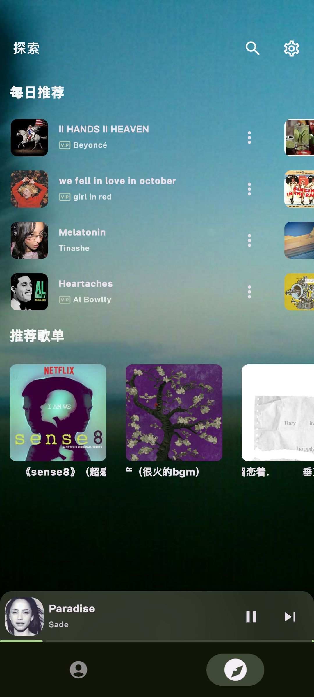
  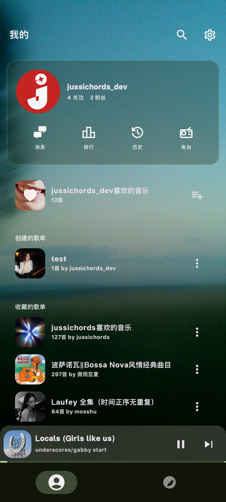
  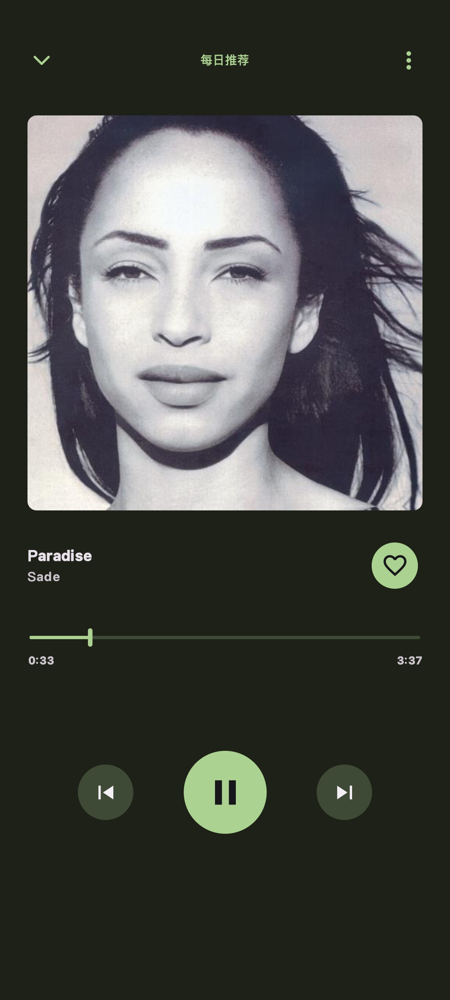
  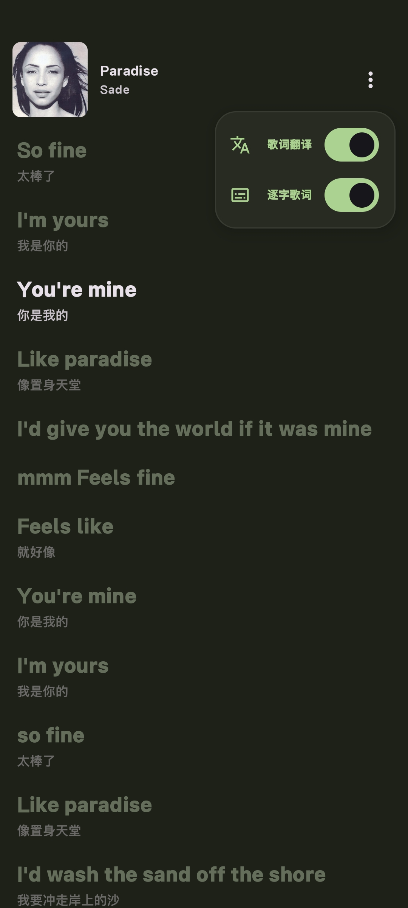
</div>

<div align="center">
  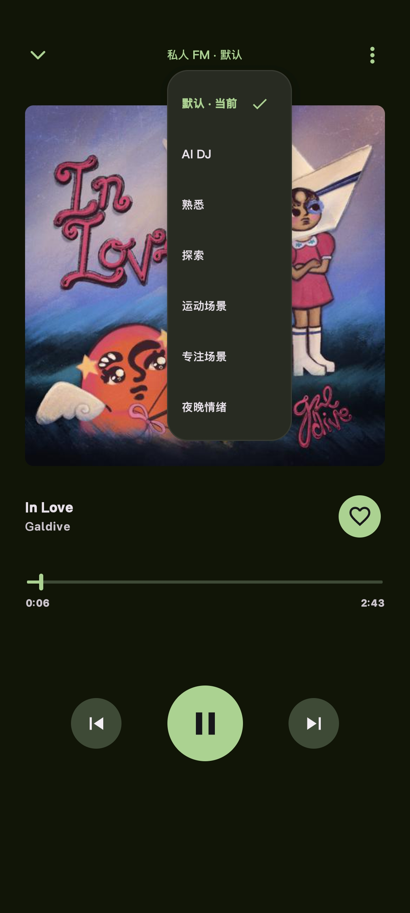
  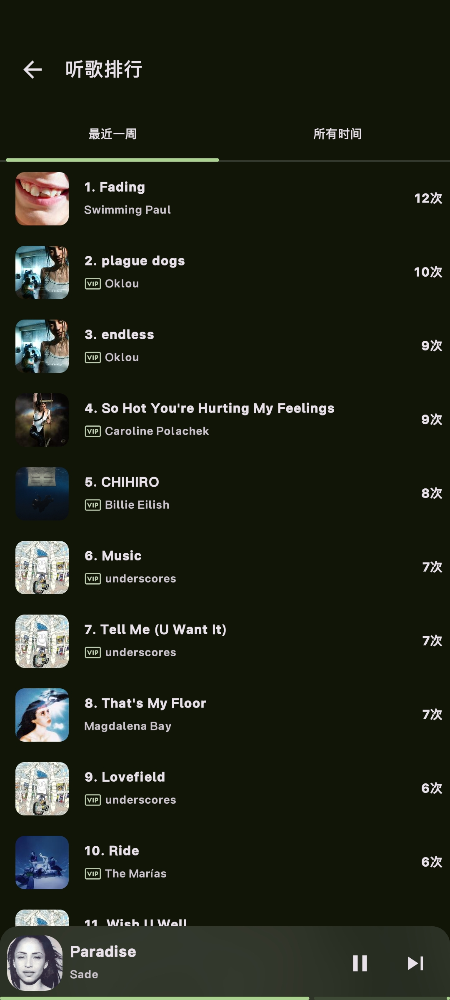
  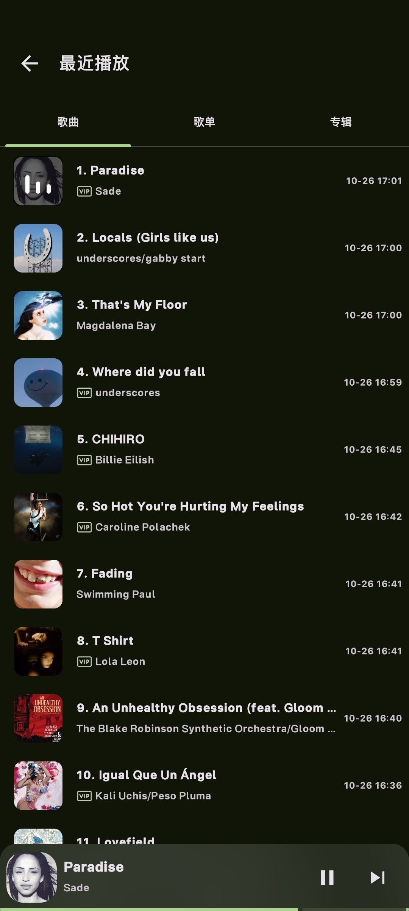
  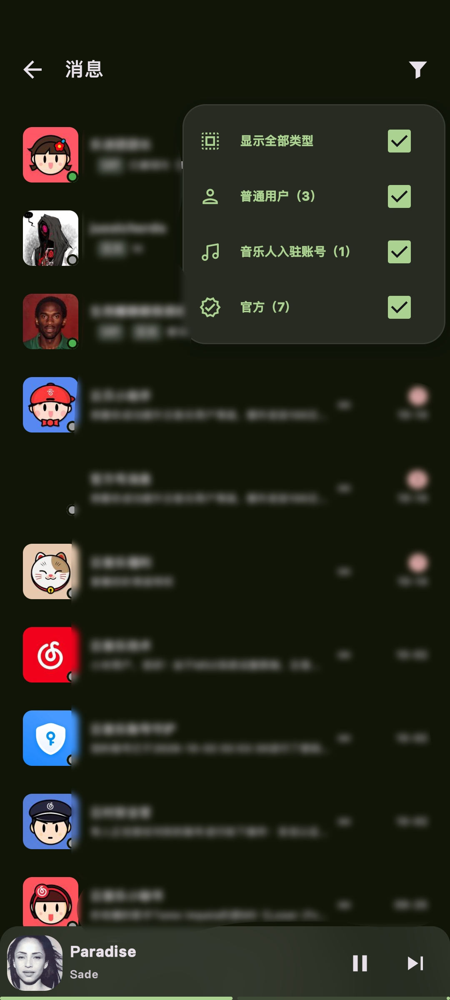
</div>

<div align="center">
  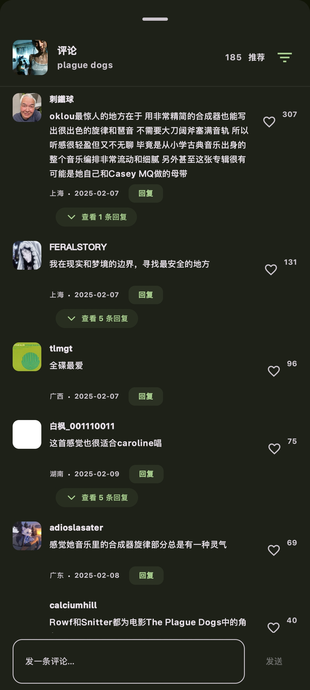
  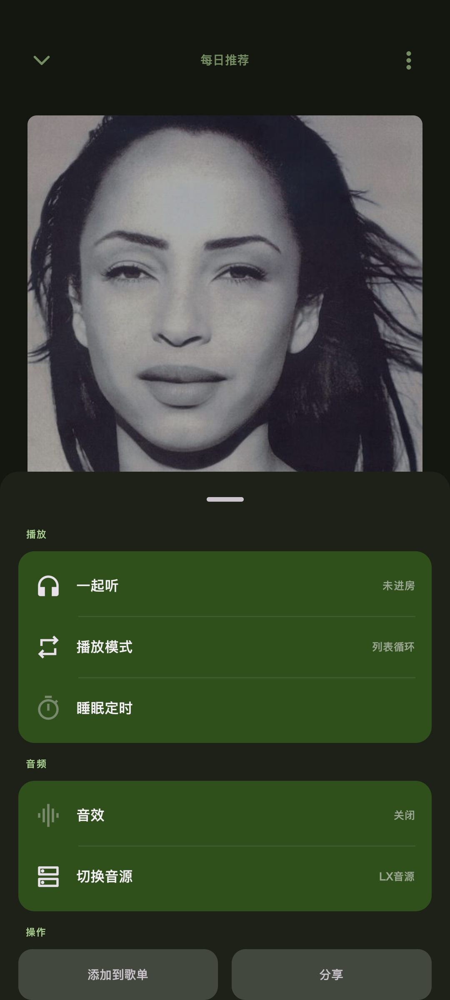
  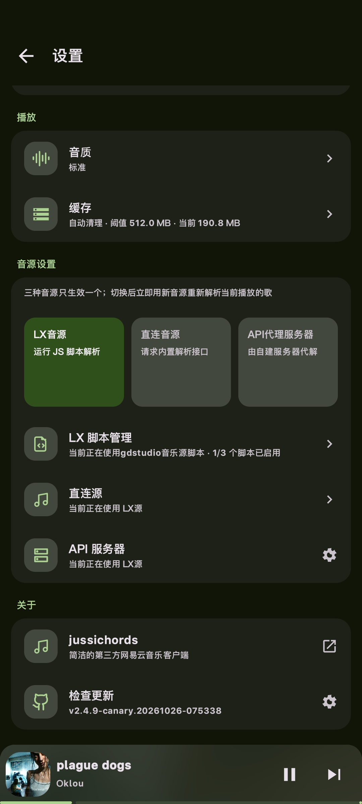
  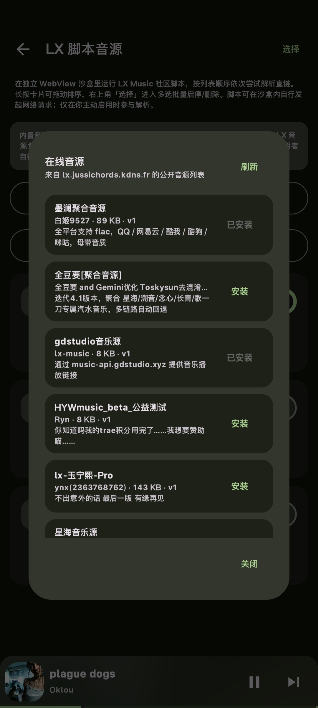
</div>

---

## 下载与反馈

- **安装包下载**：前往 [GitHub Releases](https://github.com/easyTIDollar/jussichords/releases) 获取最新预编译 Release APK

- **bug反馈与建议**：<br>
issue: [GitHub Issues](https://github.com/easyTIDollar/jussichords/issues)<br>
Telegram群组: [https://t.me/jussichords_chat](https://t.me/jussichords_chat)

---

## 项目架构

项目由两个 Gradle 模块组成，网易云原生协议层与 Android 界面、多媒体播放和业务逻辑清晰解耦：

| 模块 | 类型 | 职责 |
|---|---|---|
| `:app` | Android 应用 | Jetpack Compose 界面、Media3 播放引擎、桌面悬浮歌词服务、LX 脚本沙箱、智能缓存与业务逻辑 |
| `:ncmapi` | Android 库 | 网易云原生协议层（WeApi / EApi / LinuxApi / NCBL）、加密通道与统一数据模型 |

代码目录按业务域与基础设施组织：

```text
app/src/main/java/com/jussicodes/music/
├── MainActivity.kt              # 单 Activity 架构：系统窗口适应、权限引导
├── JetMeloApp.kt                # 顶层应用组件：导航骨架与全局图层
├── di/                          # Hilt 依赖注入模块
├── ui/                          # Compose 界面层（探索、我的、播放页、评论、消息、设置等）
├── playback/                    # Media3 音频播放服务与状态控制
├── lyric/                       # 歌词解析、实时滚动与桌面悬浮歌词服务
├── lx/                          # 落雪脚本音源解析引擎与 WebView 安全沙箱
├── data/                        # 仓储实现、DataStore 本地存储、缓存管理
└── viewModel/                   # 界面状态驱动与业务 ViewModel

ncmapi/src/main/java/com/rcmiku/ncmapi/
├── api/                         # 各业务接口（推荐、歌单、播放、评论、私信、FM、搜索等）
├── ncbl/                        # 客户端打卡与日志上报链路
├── model/                       # 业务实体数据模型（Kotlinx Serialization）
└── utils/                       # 网络请求、Cookie 管理与原生加密工具
```

---

## 核心特性

- **现代沉浸界面**：采用 Jetpack Compose 与 Material 3 构建，支持深色沉浸主题、轻毛玻璃背景与常驻底部 Mini-Player
- **简约且清晰的双tab主页**：
  - **我的**：账号信息、喜欢歌单、自建与收藏歌单
  - **探索**：每日推荐横滑卡片、推荐歌单画廊
- **私人 FM**：支持自由切换默认、AI DJ、熟悉、探索、运动场景、专注场景与夜晚情绪
- **听歌排行**：支持周榜与全部时间听歌排行（精确统计播放频次），以及歌曲、歌单、专辑三维度的播放历史
- **歌词页面**：提供「歌词翻译」与「逐字歌词」独立开关
- **桌面歌词**：退出 App 常驻显示，悬浮播控胶囊、触摸穿透锁定、字号与描边粗细调节，以及多色调色板与实时壁纸预览
- **消息中心**：聚合聊天与系统通知，支持按普通用户、音乐人入驻账号、官方通知分类屏蔽
- **歌曲评论区**：可选择 推荐/最新/热度 排序, 楼中楼、回复、IP 属地展示与点赞
- **缓存管理**：支持设置缓存上限阈值（如 512MB），超额自动清理并实时显示当前占用

---

## 构建与开发

### 环境要求

- **JDK**：Java 17
- **Android SDK**：Compile / Target SDK 34，Min SDK 26 (Android 8.0+)
- **IDE**：Android Studio Hedgehog (2023.1.1) 或更高版本

### 常用命令

- **Android 调试构建**：
  ```bash
  ./gradlew :app:assembleDebug
  ```
- **构建 Release / Canary 安装包**：
  ```bash
  ./gradlew :app:assembleRelease
  ./gradlew :app:assembleCanary
  ```

---

## 非常感谢

- [kid-depress/Mooic](https://github.com/kid-depress/Mooic) - Mooic
- [Moriafly/SaltPlayerSource](https://github.com/Moriafly/SaltPlayerSource) - 椒盐音乐
- [rinchao0721/Melodia](https://github.com/rinchao0721/Melodia) - Melodia
- [youshen2/MeloX](https://github.com/youshen2/MeloX) Apple Music 风格的第三方客户端
- [NEORUAA/MeiloX](https://github.com/NEORUAA/MeiloX) Apple Music 网易云音乐客户端
- [NeteaseCloudMusicApi](https://github.com/binaryify/NeteaseCloudMusicApi) - API
- [api-enhanced](https://github.com/NeteaseCloudMusicApiEnhanced/api-enhanced) - 增强接口与加密逻辑参考
- [LX Music (落雪音乐)](https://github.com/lyswhut/lx-music-desktop) - 优秀的开源音乐播放器与脚本音源生态
- [Jetpack Compose](https://developer.android.com/jetpack/compose) - Android 现代化声明式 UI 工具包

---

## 免责声明

1. 本项目仅供移动开发技术交流与 Android 现代化架构学习研究所用。
2. 本项目不包含任何商业目的，严禁用于任何商业变现或非法用途。
3. 软件中调用的所有音频及元数据均来源于公开网络接口，版权归属于原权利人所有。
